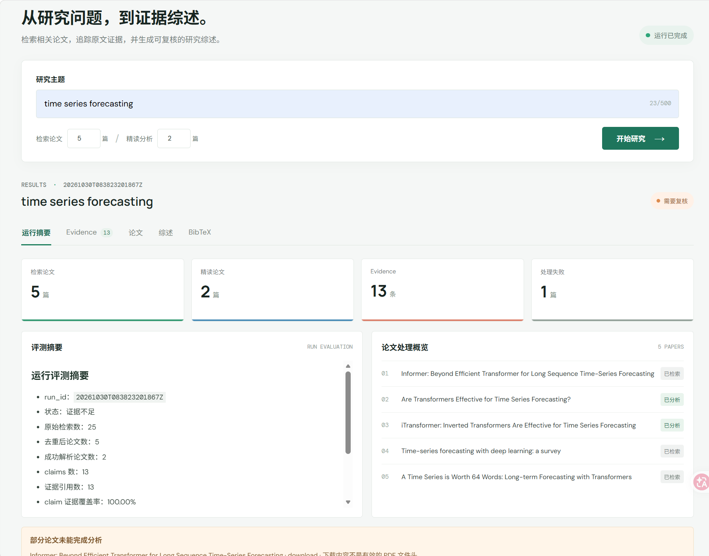
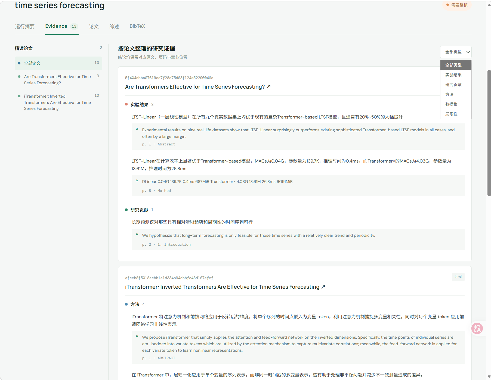
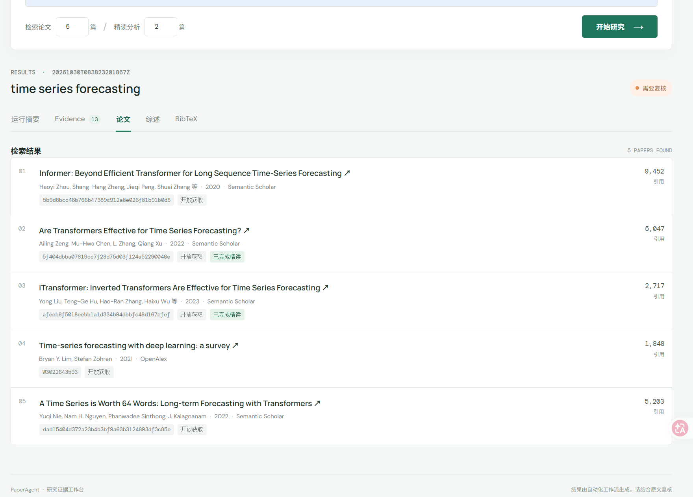
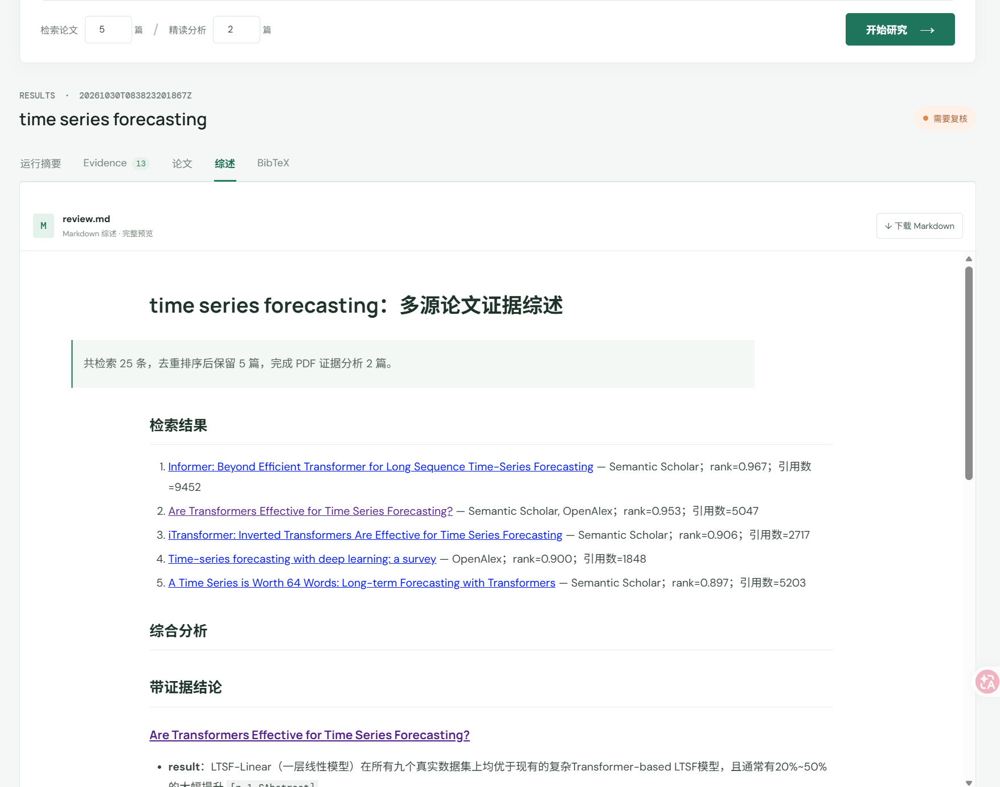
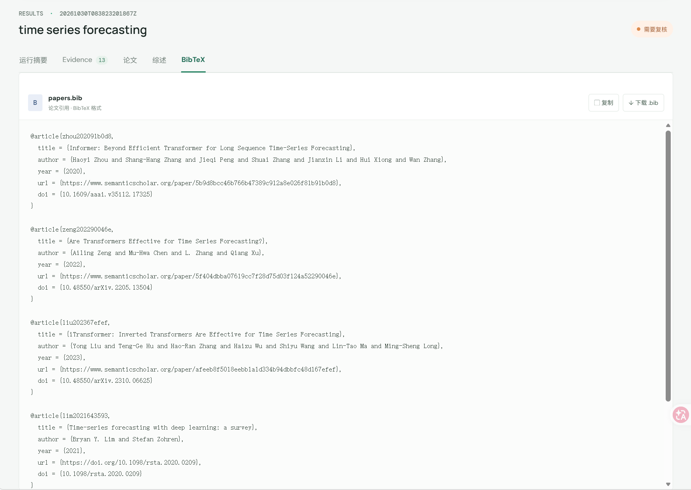

# PaperAgent

PaperAgent 是面向研究人员的论文检索与证据综述助手。用户可以通过 Web 工作台提交研究主题，设置候选检索数量和精读数量，并查看运行摘要、按论文分类的 Evidence、Markdown 综述、BibTeX 和历史任务。项目也保留命令行入口，适合开发、自动化和诊断。当前已提供本地部署与单机 Docker Compose 部署。

碎碎念：本来想做个论文提取不同分类的证据进行分析，但是目前证据提取可能不全面，并且审核只做了规则检查。最大的问题是如何全面提取论文中各个种类的evidence，再根据这些信息进行分析。因为在检索精读数量很多的情况下，也不可能将全文都输入大模型分析。后续可能会继续完善。。。

## 当前架构

```text
User Query
  -> Planner（当前固定为主题检索任务）
  -> search_papers
       -> arXiv
       -> Semantic Scholar
       -> OpenAlex
       -> DOI / arXiv ID / 标题+年份去重
       -> 相关性 + 引用量 + 开放获取 + 多源命中排序
  -> download_pdf
  -> parse_pdf (page + section + text)
  -> SQLite Evidence Store
  -> FAISS Evidence Retrieval
  -> extract_claims
  -> compare_papers
  -> Synthesis Agent (结构化 claims -> 共识 / 方法差异 / 结果矛盾)
  -> 分阶段审核
       -> claims 审核
       -> comparison 审核
       -> synthesis 审核
       -> 有界重试
  -> Markdown / BibTeX / JSONL / CSV / Eval
```

研究工作流使用 LangGraph 管理共享状态、部分失败隔离、条件路由和有界重试。Planner 目前将任务类型固定为主题检索，并非可自由规划或多跳引用扩展的通用 Agent。六个核心能力仍是独立 Python 工具函数，图负责调度。

## 技术选型

| 层 | 选择 | 原因 |
| --- | --- | --- |
| 工作流 | LangGraph `StateGraph` | 显式状态、条件边和循环上限适合 Planner/Review 的反馈路径。 |
| 检索 | arXiv + Semantic Scholar + OpenAlex | arXiv 提供预印本与公开 PDF，另外两源补充 DOI、引用量和出版元数据。 |
| HTTP/模型 | httpx + OpenAI 兼容 SDK | 业务层使用统一 Chat Completions 接口，由配置选择 Kimi 或 Qwen。 |
| PDF | PyMuPDF | 快速提取页码、文本块和字体信息，适合 MVP 的 section 识别。 |
| 主存储 | SQLite | 单机 MVP 无额外服务，支持论文、文本块、claims 和证据之间的关系查询。 |
| 运行审计 | JSONL | 流式、可读、易进入后续评测与日志系统；不是主数据库。 |
| 向量索引 | FAISS `IndexFlatIP` | 本地精确余弦检索、无需启动服务。当前使用稳定的哈希文本向量，后续可替换为语义 embedding。 |
| 输出 | Markdown + BibTeX + JSONL + CSV | 同时服务人工阅读、引用管理、程序审计和多论文比较。 |

Web 界面使用 React、TypeScript、Vite 和 FastAPI。Docker Compose 使用 Nginx 提供前端静态页面并代理 API。Redis、Milvus、LangSmith、Docling、Crossref、GPT-4 不是当前运行依赖；项目现阶段使用 SQLite、FAISS 和配置的 OpenAI-compatible LLM 服务（例如 Kimi/Qwen）。

Redis 和 LangSmith 本阶段未实现。代码仅生成本地 `trace.jsonl`，没有开启 LangSmith tracing。

## 目录结构

```text
PaperAgent/
├── .env.example                         # API Key、模型、输出和数据目录配置样例
├── Dockerfile                           # FastAPI 后端镜像
├── docker-compose.yml                   # 单机前后端服务与持久卷
├── pyproject.toml                       # 依赖、CLI、pytest 与 Ruff 配置
├── README.md                            # 架构、运行方法、存储与输出说明
├── src/paper_agent/
│   ├── cli.py                           # search/analyze/research 三个 CLI 入口
│   ├── api.py                           # FastAPI Web API
│   ├── api_manager.py                   # 后台任务、历史记录和输出适配
│   ├── config.py                        # Pydantic 环境配置
│   ├── models.py                        # 论文、PDF、证据、对比和运行模型
│   ├── exceptions.py                    # 可预期领域异常
│   ├── clients/
│   │   ├── arxiv.py                     # arXiv Atom API 客户端
│   │   ├── llm.py                       # OpenAI 兼容 Chat Completions 调用封装
│   │   ├── semantic_scholar.py          # Semantic Scholar Graph API 客户端
│   │   └── openalex.py                  # OpenAlex Works API 客户端
│   ├── services/
│   │   ├── research_workflow.py         # LangGraph 状态、节点、条件边和有界重试
│   │   ├── multi_source_search.py       # 多源容错、去重、合并与排序
│   │   ├── trace.py                     # 本地 JSONL 节点/工具审计记录
│   │   ├── pipeline.py                  # 保留的 Step 1 arXiv 固定流程
│   │   ├── evidence_pipeline.py         # 保留的 Step 2 arXiv 固定流程
│   │   ├── review.py                    # LLM/模板摘要综述服务
│   │   └── synthesis.py                 # 结构化 claims 横向综合与 LLM 调用
│   ├── tools/
│   │   ├── research.py                  # 六个可调用研究工具及六项输出生成
│   │   └── pdf.py                       # 公开 PDF 下载、哈希和 page/section 解析
│   ├── storage/
│   │   ├── database.py                  # SQLite schema 与主数据/证据写入
│   │   └── vector_index.py              # FAISS 文本块索引与召回
│   ├── evidence/extractor.py            # claim 分类、提取与 quote 原文校验
│   └── renderers/                       # 旧命令使用的 Markdown 渲染器
├── tests/                               # 客户端、去重排序、PDF、证据和图流程测试
├── frontend/                             # React + Vite 单页研究工作台
│   ├── Dockerfile                       # 前端构建与 Nginx 静态服务镜像
│   └── nginx.conf                      # 前端静态站点与 API 反向代理
├── data/                                # 运行时生成；SQLite、PDF、FAISS，不提交 Git
└── outputs/paper-agent/<run-id>/        # 单次研究任务的最终产物
```

## 本地部署

### 环境要求

- Python 3.11 或更新的 Python 3 版本。
- Node.js LTS（包含 npm），用于构建和启动前端。
- 可访问 arXiv、Semantic Scholar、OpenAlex 及所配置 LLM 服务的网络。若需要代理，需配置实际可用的代理地址。
- Windows 中文路径下建议使用普通依赖安装，不要使用 editable 安装；某些 Python 3.11 环境可能按系统编码读取 editable 安装生成的 `.pth` 文件。

### 从仓库部署

先将项目拉取到本地，并在项目根目录操作：

```powershell
git clone https://github.com/Tsukiyy/PaperAgent.git
Set-Location PaperAgent
# 创建虚拟环境
python -m venv .venv
# windows激活
.venv\Scripts\activate
# Linux激活
.venv\Scripts\Activate.ps1
python -m pip install -r requirements.txt
Copy-Item .env.example .env
```

编辑 `.env`，按需配置模型服务。使用 LLM 证据提取和综合时，至少配置：

```dotenv
LLM_API_KEY=你的模型服务密钥
LLM_BASE_URL=https://兼容服务的地址/v1
LLM_MODEL=服务端支持的模型名
```

不配置可用的模型时，可将两个 `PAPER_AGENT_EVIDENCE_PROVIDER`和 `PAPER_AGENT_SYNTHESIS_PROVIDER` 设为 `auto`，以便按配置/调用结果降级到本地模板；模板输出的综合能力和语言质量会低于 LLM 模式。Semantic Scholar 和 OpenAlex API Key 为可选项，有 Key 时通常能获得更稳定的配额。不要将真实密钥提交到代码仓库。

#### 启动后端

在第一个 PowerShell 窗口的项目根目录执行：

```powershell
$env:PYTHONPATH = (Join-Path (Get-Location) "src")
python -m uvicorn paper_agent.api:app --host 127.0.0.1 --port 8000
```

保持该窗口运行。API 地址为 `http://127.0.0.1:8000`，交互式接口文档为 `http://127.0.0.1:8000/docs`。

#### 启动前端

确保安装 [Node.js LTS](https://nodejs.org/) ，另开 PowerShell：

```powershell
Set-Location PaperAgent\frontend
npm install
npm run dev
# 访问：http://localhost:5173
```

访问 Vite 输出的本地地址，默认是 `http://localhost:5173`。Vite 会把 `/api` 请求代理到本机 FastAPI 的 8000 端口。后端和前端需要分别运行在两个终端中。

如果 8000 端口已占用，先在原后端窗口按 `Ctrl+C` 停止旧进程；也可以把后端换到其他端口，但同时需要修改 `frontend/vite.config.ts` 中的代理目标。

#### Docker 部署

仓库提供单机 Docker Compose 部署：后端运行 FastAPI，前端使用 Nginx 提供静态页面并代理 `/api`、`/docs`。SQLite、下载论文和 FAISS 文件保存在宿主机 `data/`，运行产物保存在宿主机 `outputs/`。

前置条件：安装并启动 Docker Desktop（Windows/macOS）或 Docker Engine 与 Compose 插件（Linux）。在项目根目录创建环境配置：

```powershell
Copy-Item .env.example .env
```

编辑 `.env` 并填写自己的 `LLM_API_KEY`。使用 LLM 模式时，确认 `LLM_BASE_URL` 和 `LLM_MODEL` 与服务商一致。不要将包含密钥的 `.env` 提交到 Git。

构建并后台启动容器：

```powershell
docker compose up --build -d
```

查看运行状态和后端日志：

```powershell
docker compose ps
docker compose logs -f backend
```

访问 `http://localhost:8080` 使用前端，`http://localhost:8080/docs` 查看 API 文档，`http://localhost:8080/api/health` 检查后端健康状态。停止服务但保留数据：

```powershell
docker compose down
```

更新代码后重新构建并启动：

```powershell
docker compose up --build -d
```

如果需要通过宿主机代理访问外部 API，在 `.env` 中把 `PAPER_AGENT_HTTP_PROXY` 设置为容器可达地址，例如 `http://host.docker.internal:7890`。不要使用 `127.0.0.1:7890`，该地址在容器内指向容器自身；同时确认代理程序允许 Docker 网络连接。

Compose 将 `./data` 与 `./outputs` 挂载到后端容器，`docker compose down` 不会删除这些目录。备份或迁移时保存这两个目录；`.env` 中包含密钥，应通过安全方式迁移。该部署用于单机使用，尚未配置 TLS、身份认证、用户隔离、多副本任务队列或生产级密钥管理。公开部署前应在反向代理层配置 HTTPS 和访问控制。

## 使用方式

1. 确认后端和前端都已启动，浏览器访问对应端口。
2. 在“研究主题”中输入需要检索的主题或问题。
3. 设置“检索论文”数量（1–20）和“精读分析”数量（至少 1 且不能超过检索数量）。检索数量是去重排序后保留的候选论文数；精读数量是尝试下载、解析和抽取 Evidence 的目标数量。若部分论文没有可访问 PDF，实际精读数可能少于目标值。
4. 点击“开始研究”。页面显示当前状态；任务可能需要数分钟，取决于数据源、PDF 下载和模型响应速度。任务结束后结果会显示在下方。
5. 在结果标签中查看“运行摘要”“Evidence”“论文”“综述”和“BibTeX”。Evidence 按论文及研究贡献、方法、数据集、评价指标、实验结果、局限性等类型分组，并保留原文引用、页码和章节。
6. “综述”使用 Markdown 渲染视图，可滚动阅读并下载 `review.md`；“BibTeX”可复制或下载 `.bib` 文件。
7. 点击顶部“历史任务”可搜索主题、按状态筛选并打开历史结果。历史索引和完整前端结果保存在 SQLite；Markdown、BibTeX、JSONL、CSV 和 trace 文件保留在各自运行目录。服务启动时会尝试导入已有的 `outputs/paper-agent/<run-id>/` 运行产物。

历史任务目前是单机单进程能力，不提供账号、用户隔离、任务删除或多实例共享队列。SQLite 和运行产物目录不要手动删除，否则对应历史详情或下载文件可能无法恢复。

## 命令行使用

API 和前端之外，也可以从项目根目录运行 CLI。先激活 `.venv` 并设置 `PYTHONPATH`：

```powershell
$env:PYTHONPATH = (Join-Path (Get-Location) "src")
paper-agent research "agentic RAG" --limit 5 --read-limit 3
paper-agent search "agentic RAG"
paper-agent analyze "agentic RAG" --limit 2
```

`research` 是多源 LangGraph 工作流；`search` 和 `analyze` 是保留的旧版 arXiv 工作流。

三个 LLM 功能共用 `LLM_API_KEY`、`LLM_BASE_URL`、`LLM_MODEL` 和 `LLM_MAX_TOKENS`，因此可接入任意兼容 OpenAI Chat Completions 的服务。`LLM_PROVIDER` 仅用于日志和输出标识，不参与客户端路由；切换供应商只需修改 `.env`，业务代码无需修改。任务级策略支持 `auto`、`llm` 和 `template`：`auto` 在配置缺失或调用失败时降级为本地模板，`llm` 强制调用当前模型并在配置不完整或调用失败时中止。Semantic Scholar 与 OpenAlex 的 Key 都是可选配置，但建议设置以获得更稳定的 API 配额。

OpenAlex、Semantic Scholar 和公开 PDF 下载使用 `PAPER_AGENT_HTTP_PROXY`；留空时回退到 `HTTP_PROXY`、`HTTPS_PROXY` 等系统环境代理。arXiv 保持原始 `httpx.Client` 构造方式，不读取项目专用代理字段，而是遵循 httpx 默认的环境代理行为。这样在 WSL 中可通过 `HTTP_PROXY`/`HTTPS_PROXY` 为 arXiv 提供代理，在 Windows 中也不会被错误的 `127.0.0.1` 项目配置强制重定向。

综合节点不会把 `comparison.csv` 文本直接交给模型。它先按 `comparisons` 的论文顺序，从内存中的 `analyses` 梳理出每篇论文在贡献、方法、数据集、指标、结果和局限维度下的 claims，并保留 page/section 证据定位；LLM 再基于该结构化 JSON 总结跨论文共识、方法差异和实验结果矛盾。模型被要求区分真正冲突与实验条件不同导致的不可直接比较，并为每个实质判断给出论文编号和证据位置。

## 横向综合流程

1. `extract_claims` 从论文全文中提取带类型和原文位置的 claims。
2. `compare_papers` 生成每篇论文的六维对比行，并确定横向展示顺序。
3. `build_structured_comparison` 依据该顺序直接读取 `analyses`，把 claims 组织为逐论文、逐维度的 JSON；此处不读取 CSV，也不按分隔符拆字符串。
4. `Synthesis Agent` 调用 LLM 阅读 claim 内容，分别生成总体综合、论文共识、方法差异、实验结果与矛盾、证据边界五部分。
5. LLM 的实质判断必须回指论文编号与 page/section。`auto` 模式调用失败时输出本地结构化摘要；`llm` 模式失败时明确报错。
6. `Review Agent` 继续检查原始 claims 的数量、分类和证据位置；通过后将综合结果写入 `review.md`。

## 工具边界

`src/paper_agent/tools/research.py` 对外提供以下六个函数：

- `search_papers`：调用三源，统一模型，去重、排序并将论文元数据写入 SQLite。
- `download_pdf`：仅下载元数据给出的公开 HTTP(S) PDF，输出本地路径、SHA-256 和大小。
- `parse_pdf`：输出 page、section、text chunk，写入 SQLite 并构建 FAISS。
- `extract_claims`：先从 FAISS 召回相关文本块，再生成带原文 quote、page、section 的 claims。
- `compare_papers`：按贡献、方法、数据集、指标、结果和局限生成逐论文对比行。
- `write_review`：把已审查状态导出为六项最终产物。

## 存储与输出

长期/可查询数据不放进单次输出目录：

```text
data/
├── paper_agent.db                      # runs、papers、chunks、claims、evidence 等
├── papers/*.pdf                        # 可复核公开 PDF
└── faiss/<run-id>/
    ├── chunks.faiss                    # FAISS 索引
    └── chunks.metadata.json            # 向量行到证据块的映射
```

每次成功运行严格输出：

```text
outputs/paper-agent/<run-id>/
├── review.md                           # 带论文链接和 page/section 引用的综述
├── papers.bib                          # BibTeX 引用
├── evidence.jsonl                      # claims、quote 与证据定位
├── comparison.csv                      # claims 多论文对比表
├── trace.jsonl                         # Planner、工具和 Agent 节点审计
└── eval_summary.md                     # 本次运行结构性评测摘要
```

## 验证

```powershell
pytest
ruff check .
```

## 当前限制与后续优化

当前版本已经可以完成“检索候选论文—下载公开 PDF—解析页码与章节—提取 Evidence—论文对比—生成综述—保存运行产物”的端到端流程，并提供 Web 后台任务和历史任务查看。以下能力仍属于未完成或需要继续优化的部分：

- **Docker 生产化**：已有单机 Docker Compose 部署，但尚未提供 TLS、认证、用户隔离、非 root 容器加固、自动备份和生产级密钥管理。
- **多跳检索与引用扩展**：当前工作流没有实现 `expand_citations`，不会自动沿引用/被引网络递归扩展论文。
- **Planner 自主规划**：Planner 目前固定为 `topic_research`，还不是可根据任务动态选择工具和检索策略的自主 Agent。
- **检索排序**：目前采用确定性去重和启发式排序，尚未实现 Learning-to-Rank、RRF 或引用网络排序。
- **PDF 理解**：当前主要提取文本、页码和章节，复杂表格、公式、图片说明和版面结构仍可能解析不完整。
- **向量检索**：FAISS 当前使用本地稳定的哈希文本向量，尚未接入语义 Embedding 服务或 Qdrant/Milvus 等向量数据库。
- **Evidence 质量**：已经检查 Evidence 定位、quote 和分阶段结构，但 claim 是否充分被 quote 支持、主题相关性和跨论文冲突仍需要更强的语义评测。
- **综述质量评测**：当前有单次运行结构性评测摘要；固定 20 条 query 的完整基准集、引用准确率、覆盖率、幻觉率、成本和延迟统计仍需完善。
- **评测指标口径**：现有运行摘要中的部分覆盖统计仍需统一为“有证据支撑的 claim 数 / claim 总数”，避免一条 claim 对应多条证据时出现超过 100% 的展示值。
- **任务基础设施**：历史任务使用单机 SQLite 和进程内后台任务管理器，不支持多实例共享队列、用户账号、权限隔离或任务取消。
- **数据源稳定性**：Semantic Scholar 匿名访问可能触发 429；建议配置 API Key，并根据网络环境配置有效代理。系统不会绕过付费墙。

## 运行日志与失败处理

LLM 请求错误、降级原因和其他运行日志会同步输出到后端终端，并追加保存到 `outputs/paper-agent/paper_agent.log`。网络数据源采用部分失败策略：一个 API 失败时继续使用其余来源；所有来源均失败才终止。单篇 PDF 下载、解析或证据提取失败不会伪装成结论，而会写入失败记录及综述限制说明。系统不绕过付费墙。

## 评测方向

当前 `eval_summary.md` 是单次运行的结构性检查摘要，不等同于完整的离线质量基准。后续评测计划包括：

- 检索：`Recall@K`、`Precision@K`、`nDCG` 和论文相关性人工评分。
- Evidence：claim Precision/Recall/F1、类型 Macro-F1、quote 支持度和引用位置准确率。
- 综合：共识、差异和矛盾识别准确性；是否错误比较不可比的实验结果；专家可读性评分。
- 运行：成功率、降级率、平均延迟、模型 token 与成本。

建立覆盖主题检索、单篇精读、多篇比较、失败处理和安全边界的固定评测集（规划目标为 20 条 query）后，再用于版本间对比。目前该固定评测集尚未完整实现。
